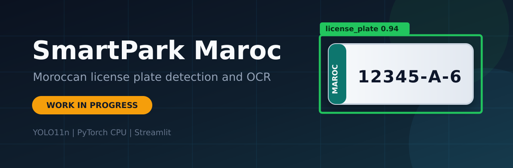
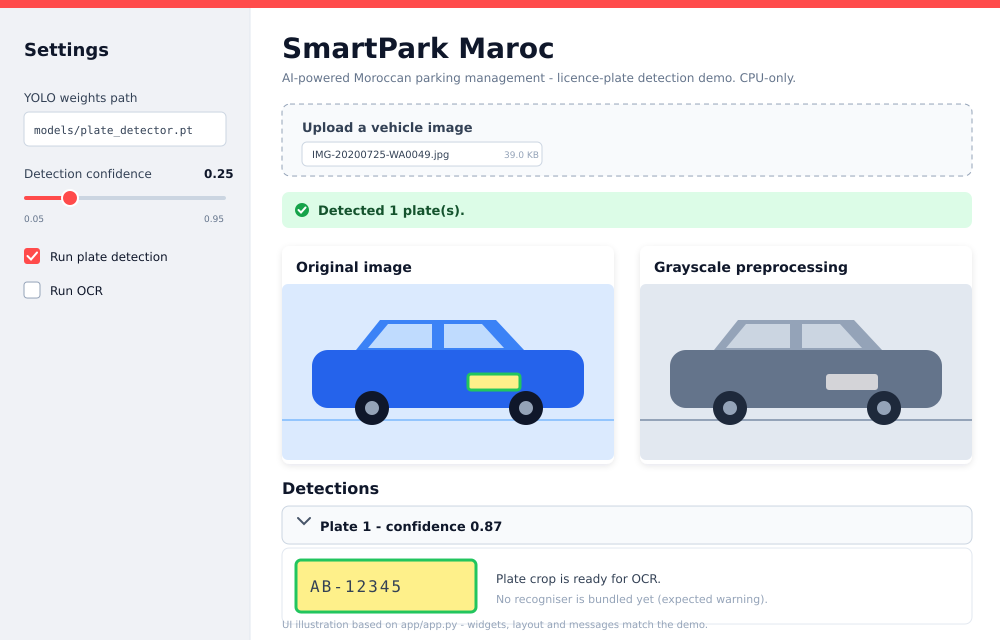
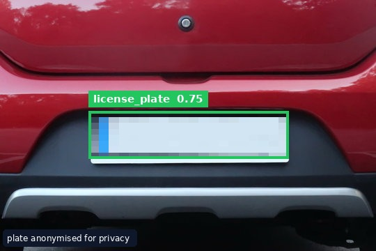
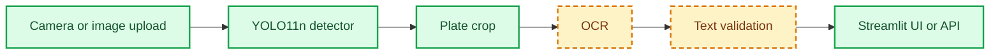
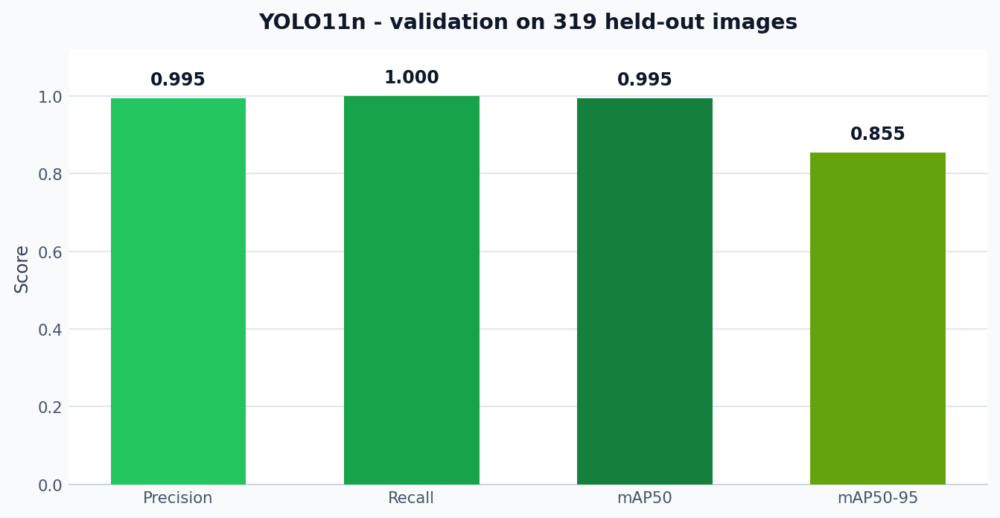
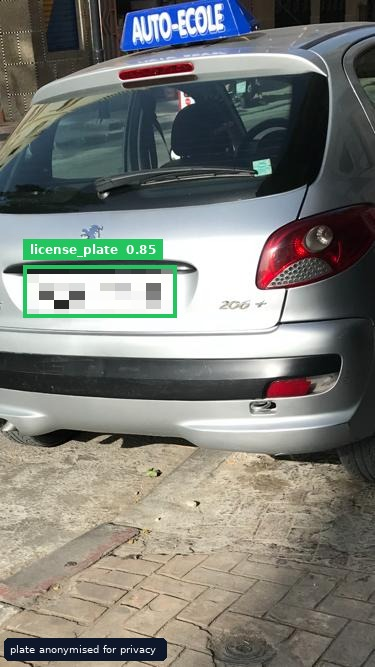

<p align="center">
  
</p>

<p align="center">
  <a href="#overview">Overview</a> &middot;
  <a href="#demo">Demo</a> &middot;
  <a href="#how-it-works">How it works</a> &middot;
  <a href="#dataset">Dataset</a> &middot;
  <a href="#results">Results</a> &middot;
  <a href="#quickstart">Quickstart</a> &middot;
  <a href="#roadmap">Roadmap</a>
</p>

<p align="center">
  
  
  
  
  
  
  
  
</p>

> **Project status: detector trained; OCR next.**
> YOLO11n was trained for 50 epochs on a Tesla T4 (Colab) and evaluated on a
> held-out validation split. Real validation metrics are reported below.
> Weights are not committed; download the checkpoint and place it at
> `models/plate_detector.pt`. Charts, CPU latency and real-world testing are
> still pending.

---

## Demo

<table>
  <tr>
    <td width="50%" align="center"></td>
    <td width="50%" align="center"></td>
  </tr>
</table>

<p align="center">
  <em>Left: the Streamlit interface (illustrated from <code>app/app.py</code>).
  Right: a real YOLO11n detection, confidence 0.75. Plate pixels are anonymised.</em>
</p>

Real inference runs on the CPU, and the annotated output is produced by the
same code that powers the demo:

```bash
python scripts/verify_model.py --image path/to/car.jpg --confidence 0.25
```

---

## Overview

SmartPark Maroc is a computer-vision system for Moroccan parking entrances.
It finds a vehicle's licence plate in a photo, crops it, and will eventually
read its characters — with a **CPU-first** design that runs on modest hardware.

```text
image -> plate detector -> plate crop -> OCR -> plate text
         [ DONE ]         [ DONE ]     [ NEXT ]
```

| 1,596 | 0.995 | ~19 min | 5.4 MB | CPU only |
|:---:|:---:|:---:|:---:|:---:|
| labelled images | validation mAP50 | T4 training run | checkpoint size | inference target |

**Why this project?** Moroccan plates mix digits, Arabic letters and a region
code. Generic OCR engines struggle with cursive script, plate fonts, dirt,
glare and camera angles. A parking system needs accuracy on imperfect images,
low latency at the entrance, and privacy by default — plate images are
personal data. This repository starts with a reproducible detection pipeline
so recognition can be added without rebuilding the system.

It is also a learning project: every design choice is documented, tested and
explained in plain language.

---

## How it works



Green = implemented. Amber = planned. The current codebase covers input, YOLO
inference, cropping and the demo UI, including local plate detection with
trained weights. OCR is an interface with preprocessing, ready for a
recogniser plug-in.

| Area | Status | Evidence |
|---|---|---|
| Environment | Done | Python 3.11, PyTorch `2.6.0+cpu`, CPU-only, 12 local tests pass |
| Dataset | Done | 1,596 image/label pairs validated, 1,277 train / 319 validation |
| Detector | Trained | YOLO11n, 50 epochs, T4; val mAP50 `0.995`, mAP50-95 `0.855` |
| OCR | Next | Preprocessing and plug-in interface only; no engine bundled |
| App | Working locally | Upload, preview and detection verified with trained weights |
| Documentation | In progress | Setup guide, environment notebook, verification docs |

No model weights or datasets are committed. See [Data and Git rules](docs/SETUP.md#6-data-and-git-rules).

---

## Dataset

The local dataset contains **1,596 Moroccan plate images**, each with one YOLO
label:

```text
images/train/IMG_0264.jpg
labels/train/IMG_0264.txt

0 0.554688 0.544434 0.580729 0.110352
```

| Property | Value |
|---|---|
| Classes | 1 (`license_plate`) |
| Boxes per image | 1 |
| Train / validation | 1,277 / 319 (80/20, seed 42) |
| Label format | YOLO normalized `class x_center y_center width height` |
| Validation errors | 0 |

Expected local layout:

```text
data/raw/plates/
├── images/train/
├── images/val/
├── labels/train/
├── labels/val/
└── data.yaml
```

The images are **not** published in this repository: plate images are personal
data and the dataset licence still needs to be confirmed.

---

## Results

Validation results from the 50-epoch YOLO11n run on a Tesla T4 (Colab):



| Metric | Value | Notes |
|---|---|---|
| Precision | 0.995 | 319-image held-out validation split |
| Recall | 1.000 | 319-image held-out validation split |
| mAP50 | 0.995 | IoU 0.50 |
| mAP50-95 | 0.855 | IoU 0.50:0.95 |
| CPU latency | Pending | Local inference works; timing not benchmarked yet |

Training configuration:

| Setting | Value |
|---|---|
| Model | YOLO11n |
| Epochs | 50 |
| Image size | 640 |
| Batch size | 16 |
| Device | Tesla T4 (Colab) |
| Training time | 0.309 h (~18.5 min) |
| Best checkpoint | 5.4 MB |
| Validation images | 319 |

### What detection looks like

<table>
  <tr>
    <td width="50%" align="center"></td>
    <td width="50%">
      <strong>Model output for one image</strong>
      <ul>
        <li><code>Detections: 1</code></li>
        <li><code>license_plate conf=0.85</code></li>
        <li><code>box=(23,265,176,317)</code> in pixels</li>
      </ul>
      The green box is drawn by <code>draw_boxes()</code>; the plate itself is
      pixelated so this README contains no readable personal data.
    </td>
  </tr>
</table>

> **Do not overclaim.** These are real validation numbers, but they come from a
> random split of one dataset. A 0.995 mAP50 on this split does not mean 99.5%
> accuracy at a real parking entrance. The next evaluation must use unseen
> cameras/scenes plus night, blur, angle and occlusion cases.

Evaluation protocol:

- held-out validation split only; no separate test set yet,
- precision, recall, mAP50, mAP50-95,
- per-failure analysis (night, blur, angle, occlusion) still pending,
- latency measured on the target CPU still pending,
- no tuning on the validation set,
- real numbers only, including failures.

---

## Quickstart

```bash
git clone git@github.com:mohamedait-abbou/SmartPark-computer-vision-project.git
cd SmartPark-computer-vision-project

conda create -y -n smartpark python=3.11 pip --no-default-packages
conda activate smartpark
python -m pip install --upgrade pip
python -m pip install -r requirements.txt

pytest
streamlit run app/app.py
```

The app opens at <http://localhost:8501>. Upload and preview work immediately.
Detection requires weights at `models/plate_detector.pt`; they are never
downloaded automatically. Tick **Run plate detection** in the sidebar to use
them.

Detailed environment notes and troubleshooting: [docs/SETUP.md](docs/SETUP.md).
First experiment without data or weights: [notebooks/01_environment_check.ipynb](notebooks/01_environment_check.ipynb).

---

## Training

The detector is a single-class YOLO11n model. CPU command for this laptop:

```bash
yolo detect train \
  data=data/raw/plates/data.yaml \
  model=yolo11n.pt \
  epochs=50 \
  imgsz=416 \
  batch=2 \
  device=cpu
```

On a free Colab T4 GPU, the same run uses `imgsz=640`, `batch=16`,
`device=0` and `patience=15`. The completed run saved its best checkpoint at
`/content/runs/smartpark/weights/best.pt`.

Download that file from Colab as `plate_detector.pt`, then place it locally:

```bash
mkdir -p models
mv ~/Downloads/plate_detector.pt models/plate_detector.pt
```

Verify the checkpoint on one validation image:

```bash
python scripts/verify_model.py
```

If it detects a plate, the script prints the box and confidence and writes
`runs/local_check.jpg`. To test your own image:

```bash
python scripts/verify_model.py --image path/to/car.jpg --confidence 0.25
```

Why YOLO11n? It is the smallest YOLO11 variant: fast enough for CPU
inference, small enough to train on free GPU hardware, and sufficient because
the plates in this dataset are large.

---

## Project structure

<details>
<summary>Show the repository layout</summary>

```text
SmartPark-Maroc/
├── app/
│   └── app.py                 # Streamlit demo
├── assets/
│   ├── banner.svg             # README artwork
│   ├── demo_ui.svg            # illustrated UI preview
│   ├── demo_detection.jpg     # real detection, plate anonymised
│   ├── validation_detection.jpg
│   └── validation_metrics.png # chart from real validation numbers
├── data/
│   ├── raw/                   # original data (ignored by Git)
│   └── processed/             # derived data (ignored by Git)
├── docs/
│   ├── SETUP.md               # full environment guide
│   └── ...                    # dataset notes and local learning material
├── models/                    # weights (ignored by Git)
├── notebooks/
│   └── 01_environment_check.ipynb
├── scripts/
│   ├── prepare_dataset.py
│   ├── make_colab_bundle.py
│   └── verify_model.py
├── src/
│   ├── detection/detector.py  # YOLO wrapper, CPU only
│   ├── processing/image_utils.py
│   └── recognition/ocr.py     # preprocessing + recogniser interface
├── tests/
│   └── test_environment.py
├── requirements.txt
└── README.md
```

</details>

Key files:

- [src/detection/detector.py](src/detection/detector.py) - lazy-loading YOLO wrapper.
- [src/processing/image_utils.py](src/processing/image_utils.py) - OpenCV helpers.
- [src/recognition/ocr.py](src/recognition/ocr.py) - OCR preprocessing and plug-in point.
- [scripts/verify_model.py](scripts/verify_model.py) - checkpoint smoke test.
- [app/app.py](app/app.py) - Streamlit interface.
- [tests/test_environment.py](tests/test_environment.py) - environment and behaviour tests.

---

## Design principles

| Principle | How it is applied |
|---|---|
| CPU-first | Inference defaults to `device="cpu"`; CUDA is rejected on purpose |
| No hidden downloads | Model weights are never fetched automatically |
| Privacy by default | Datasets and readable plate images are excluded from Git |
| Reproducibility | Pinned dependencies, fixed seed, scripted data preparation |
| Honesty | Only measured metrics are published; UI preview labelled as illustration |
| Modularity | Detector, OCR and UI can be replaced independently |

---

## Roadmap

- [x] CPU-only Python environment
- [x] Project scaffold, tests and Streamlit preview
- [x] Dataset validation and YOLO train/validation split
- [x] Documented setup and troubleshooting
- [x] Train YOLO11n and publish real validation metrics
- [x] Verify the checkpoint locally and run detection in Streamlit
- [ ] Add loss, mAP, PR and confusion-matrix charts
- [ ] Measure CPU latency
- [ ] Record a short demo GIF
- [ ] OCR baseline on Moroccan plate crops
- [ ] FastAPI service and Docker image
- [ ] `v1.0.0` release with model weights attached

---

## Limitations

- Validation metrics come from one random split of a single dataset; there is
  no independent test set or unseen-camera evaluation yet.
- Single class (`license_plate`) and a single data source.
- OCR is not implemented; only the interface and preprocessing exist.
- The demo targets CPU inference, not production throughput.
- Dataset source and licence must be documented before public redistribution.
- No production API, authentication, database or monitoring yet.

---

## Documentation

- [Setup and troubleshooting](docs/SETUP.md)
- [Environment notebook](notebooks/01_environment_check.ipynb)
- [Detector wrapper](src/detection/detector.py)
- [OCR interface](src/recognition/ocr.py)
- [Tests](tests/test_environment.py)

Learning notes and course material are kept local until reviewed for
publication.

---

## License

No code licence has been selected yet. The dataset and model weights are not
redistributed in this repository. Add a code licence and confirm the dataset
licence before reusing or redistributing any part of this project.

---

<p align="center">
Built by <a href="https://github.com/mohamedait-abbou">@mohamedait-abbou</a>
</p>
