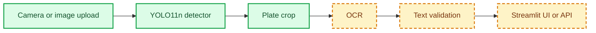

<p align="center">
  
</p>

<p align="center">
  <a href="#quickstart">Quickstart</a> &middot;
  <a href="#architecture">Architecture</a> &middot;
  <a href="#dataset">Dataset</a> &middot;
  <a href="#results">Results</a> &middot;
  <a href="#roadmap">Roadmap</a>
</p>

<p align="center">
  
  
  
  
  
  
</p>

> **Project status: work in progress.**
> The development scaffold and the dataset pipeline are ready. The detector
> has **not been trained yet**, so this README intentionally reports **no
> accuracy numbers**. Real metrics, charts, and a demo GIF will be added after
> the first training and validation run.

---

## What is SmartPark Maroc?

SmartPark Maroc is a computer-vision system for Moroccan parking entrances.
It finds a vehicle's licence plate in a photo and recognises its characters,
with a **CPU-first** design that runs on modest hardware.

```text
image -> plate detector -> plate crop -> OCR -> plate text
```

The project is built in two stages:

1. **Detection** - locate the plate with YOLO11n.
2. **Recognition** - read the plate text with OCR (next milestone).

It is also a learning project: every design choice is documented, tested, and
explained in plain language.

---

## Why this project?

Moroccan plates mix digits, Arabic letters, and a region code. Generic OCR
engines often fail on them because of cursive script, plate fonts, dirt,
glare, and camera angles.

A parking system needs three things at the same time:

- **accuracy** on real, imperfect camera images,
- **low latency** at the entrance,
- **privacy** - plate images are personal data.

This repository starts with the detection stage and a reproducible pipeline,
so the recognition stage can be added without rebuilding the whole system.

---

## Architecture



Green = implemented. Amber = planned. The current codebase covers input,
YOLO inference, cropping, and the demo UI. OCR is an interface with
preprocessing, ready for a recogniser plug-in.

---

## Current status

| Area | Status | Evidence |
|---|---|---|
| Environment | Done | Python 3.11, PyTorch `2.6.0+cpu`, CPU-only, 12 local tests pass |
| Dataset | Done | 1,596 image/label pairs validated, 1,277 train / 319 validation |
| Detector | Pending | Training not started yet |
| OCR | Pending | Preprocessing and plug-in interface only |
| App | Partial | Upload and preview work; detection needs model weights |
| Documentation | In progress | Setup guide and environment notebook available |

No model weights or datasets are committed. See [Data and Git rules](docs/SETUP.md#6-data-and-git-rules).

---

## Dataset

The local dataset contains **1,596 Moroccan plate images**, each with one YOLO
label:

```text
images/train/IMG_0264.jpg
labels/train/IMG_0264.txt

0 0.554688 0.544434 0.580729 0.110352
```

| Property | Value |
|---|---|
| Classes | 1 (`license_plate`) |
| Boxes per image | 1 |
| Train / validation | 1,277 / 319 (80/20, seed 42) |
| Label format | YOLO normalized `class x_center y_center width height` |
| Validation errors | 0 |

Expected local layout:

```text
data/raw/plates/
├── images/train/
├── images/val/
├── labels/train/
├── labels/val/
└── data.yaml
```

The images are **not** published in this repository because plate images are
personal data and the dataset licence still needs to be confirmed.

---

## Results

> **Pending.** No training run has been completed, so no metrics are claimed.

| Metric | Value | Notes |
|---|---|---|
| Precision | Pending | After training |
| Recall | Pending | After training |
| mAP50 | Pending | After training |
| mAP50-95 | Pending | After training |
| CPU latency | Pending | Measured after export |

Evaluation protocol:

- held-out validation split only,
- precision, recall, mAP50, mAP50-95,
- per-failure analysis (night, blur, angle, occlusion),
- latency measured on the target CPU,
- no tuning on the validation set,
- real numbers only, including failures.

---

## Quickstart

```bash
git clone git@github.com:mohamedait-abbou/SmartPark-computer-vision-project.git
cd SmartPark-computer-vision-project

conda create -y -n smartpark python=3.11 pip --no-default-packages
conda activate smartpark
python -m pip install --upgrade pip
python -m pip install -r requirements.txt

pytest
streamlit run app/app.py
```

The app opens at <http://localhost:8501>. Upload and preview work immediately.
Detection requires weights at `models/plate_detector.pt`; they are never
downloaded automatically.

Detailed environment notes and troubleshooting: [docs/SETUP.md](docs/SETUP.md).
First experiment without data or weights: [notebooks/01_environment_check.ipynb](notebooks/01_environment_check.ipynb).

---

## Training

The detector is a single-class YOLO11n model. CPU command for this laptop:

```bash
yolo detect train \
  data=data/raw/plates/data.yaml \
  model=yolo11n.pt \
  epochs=50 \
  imgsz=416 \
  batch=2 \
  device=cpu
```

On a free Colab T4 GPU, the same run uses `imgsz=640`, `batch=16`,
`device=0`, and `patience=15`. After training, copy the best checkpoint:

```bash
cp runs/detect/train/weights/best.pt models/plate_detector.pt
```

Why YOLO11n? It is the smallest YOLO11 variant: fast enough for CPU
inference, small enough to train on free GPU hardware, and sufficient because
the plates in this dataset are large.

---

## Project structure

<details>
<summary>Show the repository layout</summary>

```text
SmartPark-Maroc/
├── app/
│   └── app.py                 # Streamlit demo
├── assets/
│   └── banner.svg             # README artwork
├── data/
│   ├── raw/                   # original data (ignored by Git)
│   └── processed/             # derived data (ignored by Git)
├── docs/
│   ├── SETUP.md               # full environment guide
│   └── ...                    # dataset notes and local learning material
├── models/                    # weights (ignored by Git)
├── notebooks/
│   └── 01_environment_check.ipynb
├── src/
│   ├── detection/detector.py  # YOLO wrapper, CPU only
│   ├── processing/image_utils.py
│   └── recognition/ocr.py     # preprocessing + recogniser interface
├── tests/
│   └── test_environment.py
├── requirements.txt
└── README.md
```

</details>

Key files:

- [src/detection/detector.py](src/detection/detector.py) - lazy-loading YOLO wrapper.
- [src/processing/image_utils.py](src/processing/image_utils.py) - OpenCV helpers.
- [src/recognition/ocr.py](src/recognition/ocr.py) - OCR preprocessing and plug-in point.
- [app/app.py](app/app.py) - Streamlit interface.
- [tests/test_environment.py](tests/test_environment.py) - environment and behaviour tests.

---

## Design principles

| Principle | How it is applied |
|---|---|
| CPU-first | Inference defaults to `device="cpu"`; CUDA is rejected on purpose |
| No hidden downloads | Model weights are never fetched automatically |
| Privacy by default | Datasets and plate images are excluded from Git |
| Reproducibility | Pinned dependencies, fixed seed, scripted data preparation |
| Honesty | No metrics are published before a real validation run |
| Modularity | Detector, OCR, and UI can be replaced independently |

---

## Roadmap

- [x] CPU-only Python environment
- [x] Project scaffold, tests, and Streamlit preview
- [x] Dataset validation and YOLO train/validation split
- [x] Documented setup and troubleshooting
- [ ] Train YOLO11n and publish real metrics
- [ ] Add loss, mAP, PR, and confusion-matrix charts
- [ ] Record a short demo GIF
- [ ] OCR baseline on Moroccan plate crops
- [ ] FastAPI service and Docker image
- [ ] `v1.0.0` release with model weights attached

---

## Limitations

- The detector is not trained yet; no accuracy claim is made.
- Single class (`license_plate`) and a single data source.
- OCR is not implemented; only the interface and preprocessing exist.
- The demo targets CPU inference, not production throughput.
- Dataset source and licence must be documented before public redistribution.
- No production API, authentication, database, or monitoring yet.

---

## Documentation

- [Setup and troubleshooting](docs/SETUP.md)
- [Environment notebook](notebooks/01_environment_check.ipynb)
- [Detector wrapper](src/detection/detector.py)
- [OCR interface](src/recognition/ocr.py)
- [Tests](tests/test_environment.py)

Learning notes and course material are kept local until reviewed for
publication.

---

## License

No code licence has been selected yet. The dataset and model weights are not
redistributed in this repository. Add a code licence and confirm the dataset
licence before reusing or redistributing any part of this project.

---

<p align="center">
Built by <a href="https://github.com/mohamedait-abbou">@mohamedait-abbou</a>
</p>
